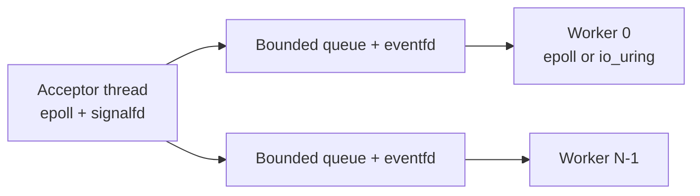

# FluxNet

FluxNet is a C++20 TCP library for Linux. The core uses sockets, epoll, eventfd, timerfd, and signalfd. io_uring is optional and is not linked unless liburing is found. There is no Boost.Asio or libuv in the core.

It is a teaching-sized reactor: one acceptor thread, N worker threads, one owner per connection, bounded queues, and explicit backpressure. It is not a claim of production readiness.

## What was measured here

These numbers are from one KVM guest (4 vCPU, kernel 6.12.113+, g++ 13.3.0, Release). The load generator and the server shared the machine. Loopback is not a NIC. The `git` field inside the JSON is `5e0a6aa` because this tree is uncommitted; that hash is only the initial README commit, not the library. Raw files are in `results/raw/`. A bar chart of those files is `results/plots/throughput.png`.

| Run | msgs/s | p50 | p99 | failures |
| --- | --- | --- | --- | --- |
| epoll, 1 worker, 1 conn, 64 B, 2 s | 80518 | 12.3 µs | 13.4 µs | 0 |
| blocking, 1 conn, 64 B, 2 s | 84762 | 11.4 µs | 14.5 µs | 0 |
| epoll, 1 worker, 10 conn, 64 B, 2 s | 209076 | 39.4 µs | 77.8 µs | 0 |
| same case, second run | 217212 | 49.7 µs | 68.6 µs | 0 |
| edge-triggered epoll, 1 worker, 10 conn, 64 B | 216320 | 43.5 µs | 54.3 µs | 0 |
| io_uring workers, 1 worker, 10 conn, 64 B | 223502 | 40.4 µs | 56.8 µs | 0 |
| thread-per-connection, 10 conn, 64 B | 206660 | 35.3 µs | 72.7 µs | 0 |
| epoll, 4 workers, 100 conn, 64 B, client threads 2 | 373133 | 130 µs | 4.13 ms | 0 |
| epoll, 1 worker, 1000 conn, 64 B | 212232 | 4.65 ms | 5.83 ms | 0 |
| 45 s smoke, epoll 2 workers, 32 conn, 64 B | 419925 | 58.4 µs | 127 µs | 0 |

The 1-connection blocking server beat the 1-worker epoll server on this guest. Four workers raised throughput and also raised tail latency; that run used more threads than the guest has CPUs. 10k connections, 1M small messages/s, and a 10-minute soak were not run. During the 1000-connection run the echo process RSS was 21152 kB and it was using about one core (`Threads: 2` in `/proc`).

## Architecture



A connection is handed to one worker and stays there. Cross-thread `send` posts to that worker's mutex queue. The accept handoff can be a lock-free SPSC ring; that does not make the server lock-free.

## Build

```bash
cmake -S . -B build -G Ninja -DCMAKE_BUILD_TYPE=Debug -DCMAKE_CXX_COMPILER=/usr/bin/g++
cmake --build build -j
ctest --test-dir build --output-on-failure
```

Release, ASan, UBSan, and TSan presets are in `CMakePresets.json`. On this machine `/usr/bin/c++` is Clang and does not find `libstdc++` unless `LIBRARY_PATH` includes the gcc library directory, so the known-good compiler is `g++`.

io_uring turns on when `pkg-config` finds liburing. Otherwise the build says so and the epoll backend remains. Boost.Asio is off unless `-DFLUXNET_ENABLE_ASIO_BASELINE=ON` and Boost is installed. It was not installed here, and no Asio baseline was built.

## Echo

```cpp
fluxnet::ServerConfig config;
config.host = "127.0.0.1";
config.port = 9000;
fluxnet::Server server(config);
server.set_on_message([](fluxnet::Connection& connection, fluxnet::MessageView message) {
    connection.send(message.type(), message.payload(), message.flags());
});
server.run();
```

`examples/echo`, `examples/pubsub`, and `examples/kv` are the three programs. Pub/sub stores connection ids, not connection objects, and fans out with `try_send`. The KV store is a mutex map with a byte cap.

## Reproduce the numbers

```bash
cmake -S . -B build-release -G Ninja -DCMAKE_BUILD_TYPE=Release -DCMAKE_CXX_COMPILER=/usr/bin/g++
cmake --build build-release -j
DURATION=2 WARMUP=0.5 bash scripts/benchmark.sh
python3 scripts/plot_results.py
```

`scripts/compare_benchmarks.py` refuses to compare JSON files whose CPU, core count, compiler, payload, or connection count differ.

## Tests

33 GoogleTest cases across 9 binaries: fd, socket, codec, queues, pool, histogram, integration (echo, limits, pub/sub, KV), SPSC threads, and an in-process fuzz driver. Debug, ASan, UBSan, and TSan each reported 9/9 ctest binaries passed on this guest. libFuzzer and Valgrind were not available. The 45 second run above is a smoke soak, not the 10-minute, 1-hour, or 24-hour script duration.

## Trade-offs

- Level-triggered epoll is the default because a missed edge is a stuck connection. Edge trigger is a config flag and reschedules explicitly when a budget stops the read before `EAGAIN`.
- The buffer pool is worker-local and capped. Retained blocks are not leaks. A flag turns the pool off.
- Output is capped. At the high watermark, reads pause and further `send` calls return `Backpressured`.
- io_uring submits one recv and one send per connection. The acceptor stays on epoll.

## Limitations

IPv4 only. No TLS, HTTP, or UDP. No Boost.Asio numbers. No Docker run (the daemon was not installed). No CrashLab repo was present; see `crashlab/INTEGRATION.md`. `perf` is not installed and `perf_event_paranoid` is 2. Details and the host facts are in `LIMITATIONS.md`.

## License

No license file is included. If you add one, MIT is a reasonable default for a small library other people will read and copy: it is short and it requires attribution. Choose Apache-2.0 instead if you want an explicit patent grant. That choice is yours; this repository does not make it.

## More

`DESIGN.md` holds the invariants. `docs/` walks the protocol, the threads, and the benchmark method. `AUDIT.md` is the review of this tree. `PROGRESS.md` is what actually ran.
