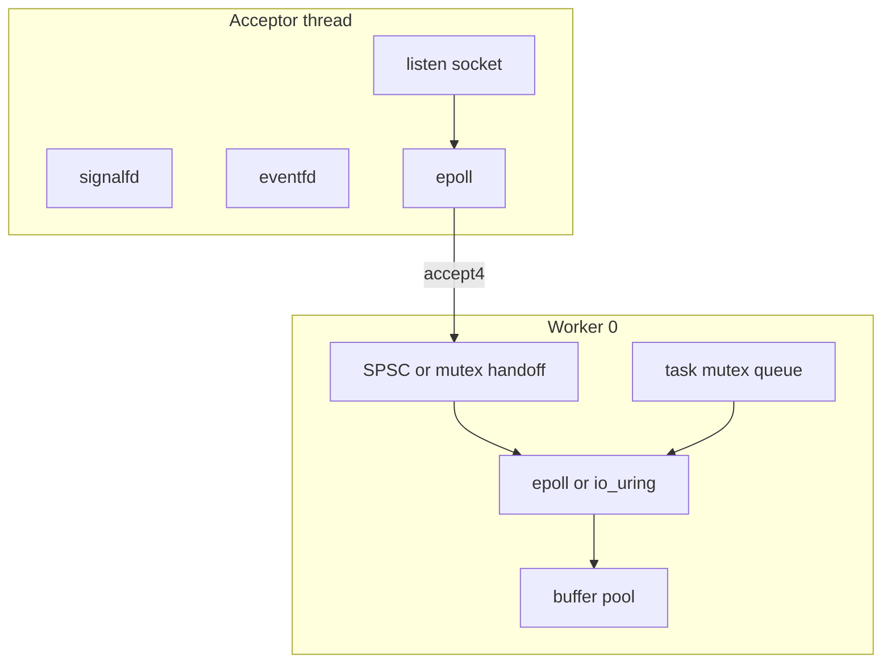

# Architecture

FluxNet is a TCP acceptor plus N worker threads. `Server::run` is the acceptor thread. It returns when the server has stopped and the workers have been joined.

Each accepted socket is reserved against `max_connections`, pushed to one worker, then the worker is woken with an eventfd. The worker creates the connection, registers it, and runs `on_connect` on that worker.

`Client` has the same workers and no acceptor. `connect()` posts a non-blocking connect to a worker.

The public headers are under `include/fluxnet/`. The reactor is in `src/core/worker.cpp`, `src/core/server.cpp`, and `src/core/client.cpp`. Epoll is `src/backends/epoll`. io_uring is `src/backends/io_uring/uring.cpp` and is only compiled when liburing is found.

Invariants are in `DESIGN.md`. The short version: one owner per connection, bounded queues, generation-checked events, buffers not freed while io_uring still has them.
